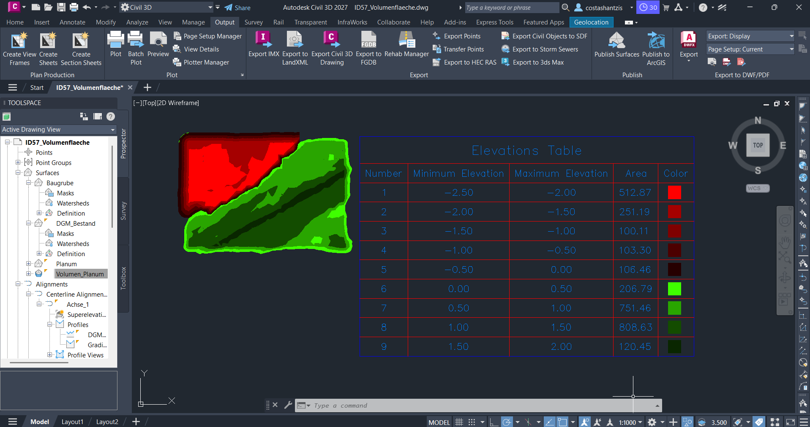
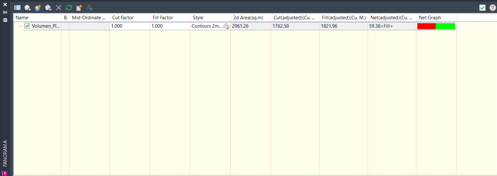
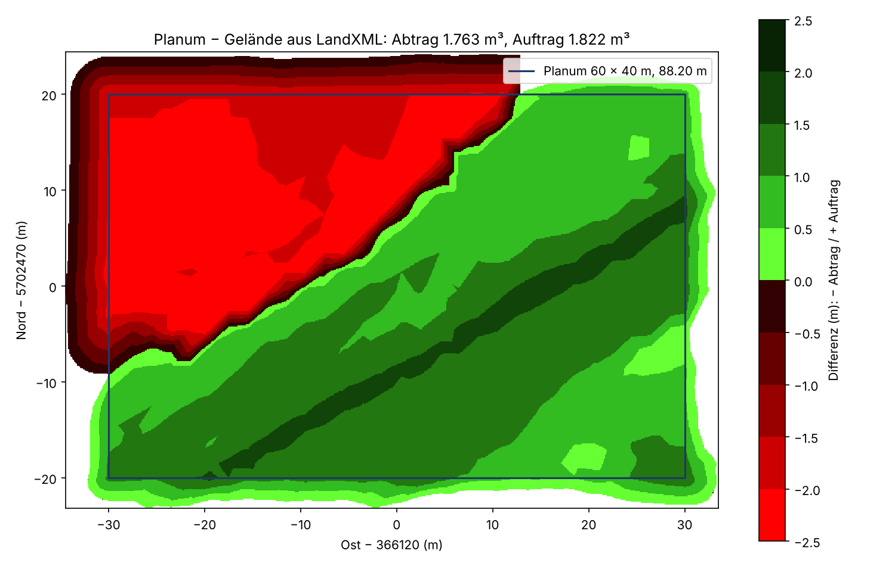
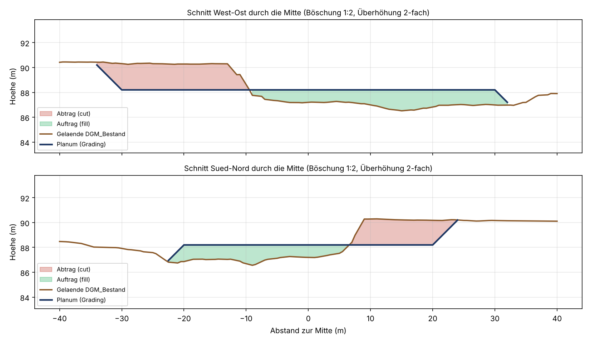

# Civil 3D – Volume Surface and Cut/Fill Balance

[English](#civil-3d--volume-surface-and-cutfill-balance) | [Deutsch](#deutsch)

A level platform on sloped terrain in **Autodesk Civil 3D 2027** with real terrain from the **DGM1 NRW (Essen)**: **platform 60 × 40 m at 88.20 m** → **feature line** → **grading with slopes 1:2** (cut and fill) → **infill** → **TIN volume surface** between existing ground and design surface in the **Volumes Dashboard** → **cut/fill map** with elevation bands and legend table → **LandXML export**. The LandXML file is then checked with **Python**: cut and fill are calculated again independently with a 0.10 m grid, plus a cut/fill map and two cross sections – a typical earthworks task (cut/fill balance) in a civil engineering or surveying office.



---

## Key results

| | |
|---|---|
| Terrain | DGM1 NRW (Essen), TIN surface **DGM_Bestand** (50,000 points, 99,102 triangles), ETRS89 / UTM 32N (EPSG:25832) |
| Platform | **60 × 40 m = 2,400 m²**, elevation **88.20 m**, centre E 366120 / N 5702470 |
| Slopes | **1:2** in cut and fill to the existing ground (*Grade to Surface*) |
| Existing ground below the platform | **86.48–90.52 m** → cut up to **2.3 m**, fill up to **1.7 m** |
| Design surface | **Planum**: 548 points, area with slopes **2,961 m²** (2D), **3,028 m²** (3D) |
| Volume surface | **Volumen_Planum** (TIN volume, base DGM_Bestand, comparison Planum) |
| Cut / fill Civil 3D | **1,762.58 m³** cut, **1,821.96 m³** fill, net **59.38 m³ fill** |
| Cut / fill Python | **1,762.7 m³** cut, **1,821.9 m³** fill (grid 0.10 m) – difference **0.0 %** |
| Cut/fill balance | fill / cut = **103 %** – the platform is almost balanced |
| Export | LandXML 1.2 with the surfaces DGM_Bestand and Planum |

**Interpretation:** a terrain step of about 3 m runs from south-west to north-east through the platform (north side about 90.3 m, south side about 87.0 m). At 88.20 m the north-west part is in cut (1,074 m²) and the larger south-east part is in fill (1,888 m²). Cut and fill are almost the same, so the excavated soil can be used for the fill; only about 60 m³ (3 %) must be brought in. Raising or lowering the platform by a few centimetres would give an exact balance – in practice the loosening and compaction factors of the soil are also taken into account. The independent calculation in Python gives the same volumes as Civil 3D.







---

## Workflow in Civil 3D

| Step | Content |
|---|---|
| **1 Drawing** | Drawing with terrain model DGM_Bestand and coordinate system **ETRS89.UTM-32N** (from the previous projects) |
| **2 Outline** | Closed polyline 60 × 40 m with absolute coordinates |
| **3 Feature line** | *Create Feature Lines from Objects*, site **Planum**, elevation **88.20 m** |
| **4 Grading group** | *Grading Creation Tools* → grading group **Planum** with automatic surface and volume base surface **DGM_Bestand** |
| **5 Grading** | Criteria *Grade to Surface*, side outside, cut and fill slope **1:2** |
| **6 Infill** | *Create Infill* for the platform |
| **7 Volume surface** | *Volumes Dashboard* → *Create new volume surface* **Volumen_Planum** (base DGM_Bestand, comparison Planum) → cut / fill / net |
| **8 Cut/fill map** | Surface style *Cut and Fill Banding*, analysis *Elevations* with interval 0.5 m and datum 0 → *Add Surface Legend Table* |
| **9 Export** | *Output → Export to LandXML* |
| **10 Check in Python** | `scripts/volumen_auswertung.py` reads both surfaces, calculates cut and fill and creates the key figures and charts |

## Limitations

- The platform is fictitious; the terrain is real
- No topsoil removal, no subgrade layers and no loosening or compaction factors (cut and fill factor 1.0)
- Slope 1:2 is a simplification; the allowed slope depends on the soil
- Civil 3D was used in the 30-day trial version (non-commercial)

---

## Repository structure

```
Civil3D-Volume-Surface-Cut-Fill/
├── data/
│   └── ID57_Volumenflaeche.xml         # LandXML export from Civil 3D
├── scripts/
│   └── volumen_auswertung.py           # cut/fill check and charts in Python
├── images/
│   ├── 01_Auftrag_Abtrag_Civil3D.png
│   ├── 02_Volumes_Dashboard_Civil3D.png
│   ├── 03_Auftrag_Abtrag_LandXML.png
│   └── 04_Schnitte_LandXML.png
├── results/
│   ├── civil3d_volumenflaeche.xlsx     # key figures and cross sections
│   ├── kennzahlen.csv
│   └── schnitte.csv
├── requirements.txt
├── LICENSE
└── README.md
```

Run the check with `pip install -r requirements.txt` and `python scripts/volumen_auswertung.py`. The LandXML file can also be opened in Civil 3D, QGIS or other CAD/GIS software.

## Tools

Autodesk Civil 3D 2027 · Grading · Volumes Dashboard · LandXML · Python · pandas · NumPy · Matplotlib · Excel

## Data sources

Digital terrain model DGM1: Geobasis NRW, Datenlizenz Deutschland – Zero – Version 2.0 (dl-de/zero-2-0), tile dgm1_32_366_5702_1_nw_2025 (section 500 × 400 m, 2 m point grid). The platform is fictitious.

## License

Code: MIT License – see [LICENSE](LICENSE)

---
---

# Deutsch

[English](#civil-3d--volume-surface-and-cutfill-balance) | [Deutsch](#deutsch)

Eine ebene Fläche (Planum) auf geneigtem Gelände in **Autodesk Civil 3D 2027** mit echtem Gelände aus dem **DGM1 NRW (Essen)**: **Planum 60 × 40 m auf 88,20 m** → **Feature Line** → **Grading mit Böschungen 1:2** (Abtrag und Auftrag) → **Infill** → **Volumenfläche (TIN Volume Surface)** zwischen Bestand und Planung im **Volumes Dashboard** → **Auftrag/Abtrag-Karte** mit Höhenklassen und Legendentabelle → **Export als LandXML**. Die LandXML-Datei wird anschließend mit **Python** geprüft: Abtrag und Auftrag werden unabhängig mit einem 0,10-m-Raster neu berechnet, dazu eine Auftrag/Abtrag-Karte und zwei Schnitte – eine typische Erdbau-Aufgabe (Massenausgleich) in einem Ingenieur- oder Vermessungsbüro.


---

## Zentrale Ergebnisse

| | |
|---|---|
| Gelände | DGM1 NRW (Essen), TIN **DGM_Bestand** (50.000 Punkte, 99.102 Dreiecke), ETRS89 / UTM 32N (EPSG:25832) |
| Planum | **60 × 40 m = 2.400 m²**, Höhe **88,20 m**, Mitte E 366120 / N 5702470 |
| Böschungen | **1:2** in Abtrag und Auftrag bis zum Gelände (*Grade to Surface*) |
| Gelände unter dem Planum | **86,48–90,52 m** → Abtrag bis **2,3 m**, Auftrag bis **1,7 m** |
| Planungsfläche | **Planum**: 548 Punkte, Fläche mit Böschungen **2.961 m²** (2D), **3.028 m²** (3D) |
| Volumenfläche | **Volumen_Planum** (TIN Volume, Bezug DGM_Bestand, Vergleich Planum) |
| Abtrag / Auftrag Civil 3D | **1.762,58 m³** Abtrag, **1.821,96 m³** Auftrag, Netto **59,38 m³ Auftrag** |
| Abtrag / Auftrag Python | **1.762,7 m³** Abtrag, **1.821,9 m³** Auftrag (Raster 0,10 m) – Abweichung **0,0 %** |
| Massenbilanz | Auftrag / Abtrag = **103 %** – das Planum ist fast ausgeglichen |
| Export | LandXML 1.2 mit den Flächen DGM_Bestand und Planum |

**Interpretation:** Eine Geländestufe von rund 3 m läuft von Südwest nach Nordost durch das Planum (Nordseite etwa 90,3 m, Südseite etwa 87,0 m). Auf 88,20 m liegt der nordwestliche Teil im Abtrag (1.074 m²) und der größere südöstliche Teil im Auftrag (1.888 m²). Abtrag und Auftrag sind fast gleich – der Aushub kann für die Auffüllung verwendet werden, nur etwa 60 m³ (3 %) müssen angeliefert werden. Mit einer um wenige Zentimeter geänderten Planumshöhe wäre die Bilanz genau ausgeglichen; in der Praxis rechnet man zusätzlich mit Auflockerungs- und Verdichtungsfaktoren. Die unabhängige Berechnung in Python ergibt dieselben Mengen wie Civil 3D.

---

## Arbeitsablauf in Civil 3D

| Schritt | Inhalt |
|---|---|
| **1 Zeichnung** | Zeichnung mit DGM_Bestand und Koordinatensystem **ETRS89.UTM-32N** (aus den vorherigen Projekten) |
| **2 Umriss** | Geschlossene Polylinie 60 × 40 m mit absoluten Koordinaten |
| **3 Feature Line** | *Create Feature Lines from Objects*, Site **Planum**, Höhe **88,20 m** |
| **4 Grading Group** | *Grading Creation Tools* → Grading Group **Planum** mit automatischer Fläche und Bezugsfläche **DGM_Bestand** |
| **5 Grading** | Kriterium *Grade to Surface*, Seite außen, Böschung Abtrag und Auftrag **1:2** |
| **6 Infill** | *Create Infill* für das Planum |
| **7 Volumenfläche** | *Volumes Dashboard* → *Create new volume surface* **Volumen_Planum** (Bezug DGM_Bestand, Vergleich Planum) → Abtrag / Auftrag / Netto |
| **8 Auftrag/Abtrag-Karte** | Flächenstil *Cut and Fill Banding*, Analyse *Elevations* mit Intervall 0,5 m und Bezug 0 → *Add Surface Legend Table* |
| **9 Export** | *Output → Export to LandXML* |
| **10 Prüfung in Python** | `scripts/volumen_auswertung.py` liest beide Flächen, berechnet Abtrag und Auftrag und erzeugt Kennzahlen und Grafiken |

## Einschränkungen

- Das Planum ist fiktiv, das Gelände ist echt
- Kein Oberbodenabtrag, keine Tragschichten und keine Auflockerungs- oder Verdichtungsfaktoren (Faktor 1,0)
- Böschung 1:2 ist vereinfacht; die zulässige Neigung hängt vom Boden ab
- Civil 3D wurde in der 30-Tage-Testversion (nicht kommerziell) verwendet

## Werkzeuge

Autodesk Civil 3D 2027 · Grading · Volumes Dashboard · LandXML · Python · pandas · NumPy · Matplotlib · Excel

## Datenquellen

Digitales Geländemodell DGM1: Geobasis NRW, Datenlizenz Deutschland – Zero – Version 2.0 (dl-de/zero-2-0), Kachel dgm1_32_366_5702_1_nw_2025 (Ausschnitt 500 × 400 m, 2-m-Punktraster). Das Planum ist fiktiv.

## Lizenz

Code: MIT License – siehe [LICENSE](LICENSE)
